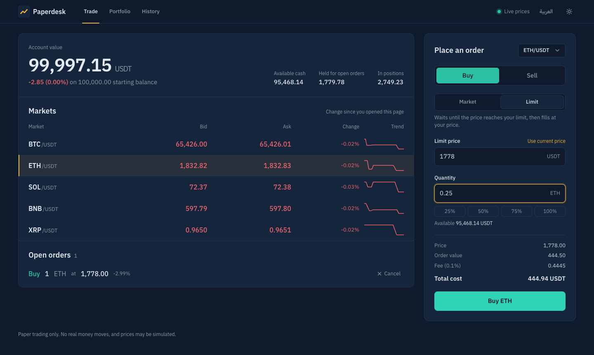
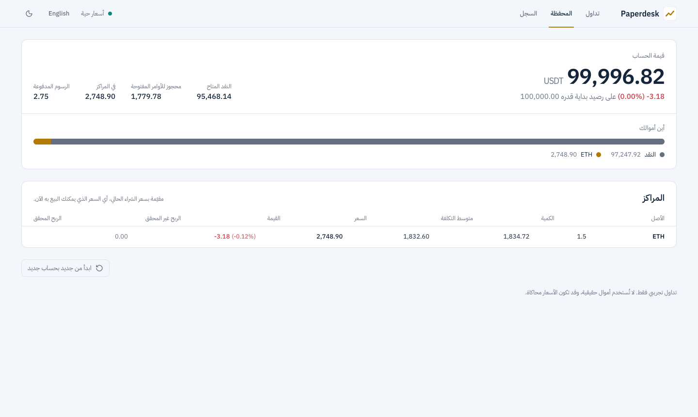
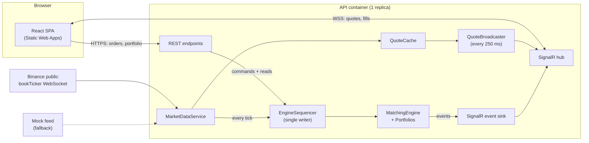

# Paperdesk: a miniature paper-trading platform

Practise trading crypto with virtual money against **live Binance prices**: market and limit orders, a matching simulator, a portfolio with realized and unrealized P&L, real-time updates, English and Arabic (RTL).

| | |
|---|---|
| **Live app** | https://zealous-glacier-0f78a8c00.5.azurestaticapps.net |
| **API docs (OpenAPI / Scalar)** | https://papertrading-api.lemonpebble-69e5e016.northeurope.azurecontainerapps.io/docs |
| **Stack** | .NET 10 · ASP.NET Core · SignalR · React 19 · TypeScript · Azure Container Apps · Azure Static Web Apps · GitHub Actions |



<details>
<summary>Arabic, light theme</summary>


</details>

---

## Contents
1. [Run it](#run-it)
2. [Architecture](#architecture)
3. [Key decisions and why](#key-decisions-and-why)
4. [Testing](#testing)
5. [Azure, CI/CD and security](#azure-cicd-and-security)
6. [Trade-offs](#trade-offs)
7. [With more time](#with-more-time)
8. [At 1,000× the users](#at-1000-the-users)
9. [API reference](#api-reference)
10. [Repository layout](#repository-layout)
11. [Use of AI tools](#use-of-ai-tools)

---

## Run it

### Everything in Docker (one command)
```bash
docker compose up --build
```
Open http://localhost:8080, and http://localhost:8080/docs for the interactive API reference. The API container isn't published directly: nginx is its only entry point, which is what makes trusting its forwarded client IP for rate limiting safe.
It uses live Binance prices; if Binance is unreachable it switches to a simulated feed automatically, and the UI says so.
To force simulated prices: `MARKET_DATA_PROVIDER=Mock docker compose up --build`.

### Local development
Prerequisites: .NET SDK 10, Node 22+.
```bash
# API on :5080
cd backend
dotnet run --project src/PaperTrading.Api --urls http://localhost:5080

# Frontend on :5173 (proxies /api and /hubs to :5080, so no CORS setup needed)
cd frontend
npm install
npm run dev
```

### Tests
```bash
cd backend && dotnet test                             # 125 tests: domain, application, infrastructure, architecture rules, HTTP
cd frontend && npm test                               # 43 tests: validation, rounding, session recovery, import boundaries
cd frontend && npm run lint && npm run typecheck
cd e2e && npm install && npm test                     # real-browser trade flow against docker compose
cd e2e && BASE_URL=https://zealous-glacier-0f78a8c00.5.azurestaticapps.net npm test   # ...or the deployment
cd e2e && LATENCY_MS=400 npm test                     # ...with injected network latency
```
The e2e test drives the installed Chrome headlessly (`playwright-core`, no browser download).

---

## Architecture



**Flow of an order:** `POST /api/orders` → validated and queued on the sequencer → the single engine thread checks idempotency, validates, reserves funds and fills or rests the order → the HTTP caller gets the result → fill events are pushed to that account's SignalR group.

**Flow of a price:** Binance `bookTicker` (best bid/ask) → parsed straight to `decimal` → queued on the sequencer, so every tick reaches the engine and can trigger resting limit orders → also written to a cache that is broadcast to browsers, coalesced to 4 updates per second.

**Architecture style:** a monolith built with Clean Architecture (ports and adapters). Inside it, the matching engine runs on a single writer thread, LMAX-style, behind use cases (`ITradingService`).

### Layering (Clean Architecture, enforced by tests)

```
PaperTrading.Api ──────────▶ PaperTrading.Infrastructure ──▶ PaperTrading.Application ──▶ PaperTrading.Domain
(endpoints, contracts,        (Binance + mock feeds,          (use cases: ITradingService,   (Order, Portfolio, Money,
 SignalR, auth: composition    feed failover, instrument       single-writer sequencer,       MatchingEngine)
 root)                         catalog)                        ports, market-data ingestion)  no dependencies at all
```

| Project | Responsibility | May depend on |
|---|---|---|
| **Domain** | Entities, money rules, the matching engine. Plain synchronous C# with no I/O, no locks and **no package references**. | nothing |
| **Application** | Use cases (`ITradingService`), the sequencer that serializes them, market-data ingestion, and the **ports** other layers implement: `IQuoteSource`, `IInstrumentCatalog`, `IEngineEventSink`. | Domain |
| **Infrastructure** | Adapters: Binance and mock feeds, feed failover policy, instrument catalog. | Application |
| **Api** | HTTP endpoints, request/response **contracts** mapped from domain snapshots, SignalR, auth, CORS, rate limits. `Program.cs` is the composition root. | Application, plus Infrastructure for wiring only |

- **Rules are tests, not conventions.** `LayerDependencyTests` fails the build if the domain gains a framework or JSON dependency, if Application references Infrastructure or ASP.NET, or if any API type touches `MatchingEngine`, `Order` or `Portfolio` directly. Each rule was checked by planting a violation and watching it fail.
- **Contracts are separate from the domain.** Clients never see engine internals (account id, sequence numbers, idempotency keys), and the domain can change without breaking the API.
- **Interfaces only where they earn their keep:** ports with more than one implementation (`IQuoteSource`: Binance, mock, the tests' manual feed) or that cross a boundary outward (`IEngineEventSink`, `ITradingService`). There's no repository or mediator layer wrapped around an in-memory engine.
- The sequencer and `TradingService` are `internal`, so nothing outside Application can bypass the use cases.

---

## Key decisions and why

### 1. Concurrency: a single-writer sequencer instead of locks
Every state change (place order, cancel, price tick) and every account read goes through **one `Channel<T>` consumed by one loop** that owns the engine.

- **Correct by construction.** There is a total order of events, so "an order arrives while the price moves" or "two orders spend the same cash" cannot interleave. There is nothing to lock, so no deadlocks and no lock-ordering rules.
- **Simple, testable domain code.** The engine is ordinary synchronous C#; tests call it directly and get deterministic results.
- **Proven pattern.** It's how exchange matching engines are commonly built (the LMAX disruptor style): one fast thread per partition, scaled by **sharding**, not by locking.
- Details that matter: callers' continuations run off the engine thread (`RunContinuationsAsynchronously`), the queue is bounded with back-pressure rather than dropping orders or ticks, and outbound events are handed to a separate channel so a slow browser can never stall matching.

The concurrency tests fire 250 simultaneous market orders at an account that can afford exactly 100 of them: exactly 100 fill, 150 are rejected, and cash ends at exactly 0.

### 2. Money: `decimal` everywhere, with one rounding policy
- `decimal` for every price, quantity, cash amount, fee and P&L. Binance sends prices as JSON strings; they're parsed straight into `decimal`, so no `double` is ever involved.
- All rounding is in one place (`Money.cs`). Quote currency (USDT) is kept to 8 decimal places. **Fees round up**, so rounding never favours the trader.
- **Cost basis is stored as a total, not an average.** Selling part of a position relieves a pro-rata share; closing the whole position relieves exactly what is left. That means **no rounding residue ever builds up**. Average cost is derived for display only.
- A randomized test (4,000 operations × 3 seeds) checks after every step that this identity holds **exactly**:
  `Cash + Σ CostBasis == InitialCash + RealizedPnl`.
  Injecting a deliberate 0.00000001 USDT error makes 5 tests fail, so the tests do catch drift.
- **The API serializes money as JSON strings** (`"5006.001"`). JavaScript parses JSON numbers into doubles, which would silently corrupt values. The client keeps them as strings and does arithmetic with `decimal.js`; `Intl.NumberFormat` formats the strings exactly.

### 3. Matching rules
| Order | Rule |
|---|---|
| Market buy / sell | Fills immediately at the **ask** / **bid**. Refused if there is no quote or the last quote is more than 10 s old. |
| Limit, marketable on arrival | Fills immediately at the current touch, which is at least as good as the limit (price improvement). |
| Limit, not marketable | Rests on the book with funds reserved, and fills **at its limit price** as soon as the touch crosses it (buy: ask ≤ limit; sell: bid ≥ limit). |

- **Price-time priority** per symbol: better prices first, then first come, first served (`SortedSet` ordered by price, then arrival sequence).
- **Reservations:** a resting buy reserves `qty × limit + fee`; a resting sell reserves its quantity. A triggered order therefore can't fail for lack of funds, and the same cash or coins can't be committed twice. Cancelling releases the reservation.
- **Exchange-style instrument rules** (tick size, step size, minimum order value, modelled on Binance) are validated before an order is accepted.
- **Spot, long-only**: no shorting, no margin.

### 4. Idempotent order submission
- `POST /api/orders` requires an `Idempotency-Key` header, scoped per account.
- The key is checked **on the engine thread, atomically with order creation**. Thirty concurrent retries with the same key create exactly one order (tested over HTTP).
- Same key and same body: the original order is replayed (`200`, `Idempotent-Replayed: true`). Same key with a different body: `409`.
- Business rejections (insufficient funds, stale price) are recorded as `Rejected` orders and replay the same way. Malformed requests (`400`) don't use up the key.
- The client generates one key per click and reuses it if it retries after a network failure, so a flaky connection can never buy twice.
- Once queued, an order executes even if the client disconnects; the client retries with the same key to learn the outcome.
- Keys are remembered for 24 hours (or until their order leaves the capped history, below); after that the same key starts a new order.

### 5. Market data and failover
- `IQuoteSource` has two implementations: Binance's public `bookTicker` stream (no API key) and a seeded random-walk mock.
- **Failover:** after repeated connection failures the service switches to the mock feed, retries Binance every 2 minutes, and uses a 10 s connect timeout plus an idle watchdog.
- **The mock continues from the last real price.** An earlier version restarted from fixed reference prices: BTC jumped from about 64k to 95k on failover, which would have filled resting limit orders at prices the market never traded. Found while testing in Docker, fixed, and covered by a test.
- The UI shows "Live prices", "Simulated prices" or "Prices paused", so users are never misled about where prices come from.

### 6. API conventions
- Errors are RFC 7807 problem details with a **stable machine `code`** (`insufficient_funds`, `stale_market_data`…). The frontend translates codes, so both languages get proper messages instead of English server strings.
- Status codes: `201` for a new order, `200` for a replay, `422` for a business rejection (the body includes the recorded order), `400` for validation errors, `409` for an idempotency conflict or cancelling a finished order.
- Enum values must be sent as names, not numbers (`allowIntegerValues: false`). Decimal strings accept plain notation only (`"1e3"` is rejected).

### 7. Accounts and auth
`POST /api/sessions` creates an anonymous paper account (100,000 USDT) and returns a signed JWT. The account id is the token's subject, so one user can never see another's orders. There's no sign-up, so reviewers can use the app immediately. SignalR authenticates with the same token, sent as a query parameter because browsers can't set headers on WebSockets.

All state lives in one process, so everything an anonymous client can create is capped (`TradingOptions`): 20,000 accounts (beyond that, sign-up returns `503` with code `capacity_reached`, which the UI explains in both languages), the 500 most recent finished orders and 500 trades per account (open orders are never dropped, since they hold reservations), and idempotency keys for 24 hours.

### 8. Frontend
- **React 19 + Vite + TypeScript (strict)**, TanStack Query for server state, a small external store (`useSyncExternalStore`) for high-frequency quotes, `motion` for animation, Tailwind 4 with design tokens.
- **Feature-based structure with enforced boundaries.** `app/` wires `pages/`, which compose `features/{market,trading,portfolio,history}`, which build on `shared/{api,ui,lib,i18n,realtime}`. Features expose a public `index.ts` and import each other only through it, `shared/` imports nothing above it, and a test fails the build on any violation. Behaviour lives in hooks (for example, `useOrderTicket` is the ticket's view-model) and components only render.
- **Code splitting:** the landing page ships in the main bundle and the other routes load on first visit. Libraries are split into long-cacheable chunks (React, Motion, SignalR, other vendors), so a deploy only changes the app chunk: about 19 KB gzipped instead of the whole 212 KB bundle.
- **Validation mirrors the server's rules** (step size, tick size, minimum value, funds including fees, available position) for instant feedback; the server stays the authority.
- **Live valuation:** balances come from the server, and positions are re-marked client-side from the quote stream, so account value ticks in real time between refetches.
- **Arabic and English:** `dir` and `lang` switch on `<html>`, layout uses CSS logical properties so it mirrors automatically, numbers and pairs are isolated left-to-right, digits stay Western in Arabic (as most Arabic trading apps do), and Arabic-Indic digits typed into inputs are accepted.
- **Motion with meaning:**
  - account value with rolling digits
  - price text coloured by its last move, with a short pulse on each tick
  - sliding selection and toggle indicators
  - orders animating in and out
  - `prefers-reduced-motion` respected
- **Accessibility:** keyboard-operable market grid and radio groups, visible focus, `aria-invalid`/`aria-describedby` on fields, screen-reader text for animated numbers.

---

## Testing

| Suite | What it covers |
|---|---|
| `PaperTrading.UnitTests` (91): domain | Portfolio math (fees, weighted cost, partial/full close, no residue, mark-to-bid), every matching rule, price-time priority, reservations, cancel, validation, idempotency (replay, conflict, scope, normalization, expiry), memory caps (accounts, history, trades), errors never echo input, events |
| ↳ Accounting invariants | 4,000 random orders, cancels and ticks across 3 accounts and 2 symbols per seed; exact accounting identity, non-negative balances, reservations equal open orders, fees reconcile |
| ↳ Sequencer concurrency | 250 racing orders never overspend; 100 concurrent duplicates make 1 order; orders racing price ticks keep reservations consistent; a failing operation faults only its caller |
| ↳ Application, infrastructure, architecture | Use cases against one engine; feed failover and primary retry; mock feed seeded from the last real price; exact Binance parsing; layer-dependency rules |
| `PaperTrading.Api.IntegrationTests` (34) | Auth, idempotency over HTTP (including 30 concurrent requests), status codes and error codes, decimals as strings, response contracts without internals, malformed bodies, cross-account isolation, SignalR push, hardening headers (and no `Server` banner, on real Kestrel), a spoofed `X-Forwarded-For` can't escape the rate limit, sign-up at capacity |
| Frontend (43) | Ticket validation and estimates, exact fee rounding, "use 100%" never exceeds cash, Arabic digit input, exact number formatting, idempotency-key reuse after network failures, session recovery from stale 401s, a refused sign-up surfaces its error code, stale-quote ordering, page-load error boundary, import-boundary rules |
| `e2e/` (12 steps) | Real Chrome against Docker or Azure: security headers on the page and its assets and `404` for dot-paths, live prices stream, market buy, resting limit, reservation blocks a double sell, cancel, sell, history, portfolio, reload keeps the session, Arabic RTL, and zero console or CSP errors |

**Static review.** The codebase was also reviewed with CodeRabbit. Each of its 39 findings was checked against the code: 24 were real issues and are fixed, each with a regression test where testable (for example, a 10²⁴-sized order overflowing decimal arithmetic after it had already been recorded, and a stale `401` creating an extra session). 10 were false positives, and 5 were design trade-offs or test-only nitpicks, which stay documented. A second, Claude-based review found 8 more, all fixed with tests. The most important: a token signed before a restart could outlive its in-memory account, so users silently got an empty account instead of being told the server had restarted. Others were a failed "start over" being mistaken for a first visit, and gateway timeouts not being treated as "outcome unknown" for idempotency.

**Security assessment.** A separate security assessment combined a code and infrastructure review, a secret scan of the full git history, a dependency audit and non-destructive tests against the live deployment. It found no Critical or High issues. Its Medium and Low findings are fixed (memory caps, SHA-pinned actions, API hardening headers, a narrower deploy role, and the others listed under [security](#no-secrets-in-source-or-in-github)) or are deliberate trade-offs listed under [Trade-offs](#trade-offs). Each fix that can be tested has a regression test, and the important ones were checked by removing the fix and watching the test fail. Writing those tests also caught a bug in the new history pruning: dropping an old order could forget an idempotency key that had since been reused for a newer order, so a retry of the newer order would have bought twice.

Several real bugs were found by running the stack the way users would (Docker and the deployed site) rather than by unit tests alone:
- the failover price jump above
- fonts blocked by the CSP
- three timing bugs that only appear with real network latency:
  - the order ticket validated against stale balances right after a cancel
  - it cleared input typed while the previous order was still settling
  - "Open orders" could stay empty after the first session was created

`LATENCY_MS` now reproduces these deterministically.

---

## Azure, CI/CD and security

### Resources ([`infra/main.bicep`](infra/main.bicep))
| Resource | Plan | Notes |
|---|---|---|
| Static Web App | Free | SPA, SPA routing fallback, security headers and CSP |
| Container App | 0.25 vCPU / 0.5 GiB, **min = max = 1 replica** | In-memory engine state requires exactly one always-on instance |
| Container Registry | Basic | Admin user disabled; the app pulls with a **user-assigned managed identity** (AcrPull) |
| Log Analytics | Pay per GB | Container logs, within the free allowance |

The API runs in **North Europe**: it must be outside the US (Binance geo-blocks US IP ranges), and West Europe was refusing new trial customers at deploy time. Health probes use liveness only, so a Binance outage doesn't take the single replica out of rotation; the app falls back to simulated prices instead.

### Pipeline ([`.github/workflows/ci-cd.yml`](.github/workflows/ci-cd.yml))
1. On every push and PR: **backend** (restore, build, test, upload results) and **frontend** (lint, type-check, test, build) in parallel.
2. On `main`, after both pass: **deploy API**: build the `linux/amd64` image with layer caching, push it tagged with the commit SHA, roll out a new revision, then smoke-test `/health/live` and `/api/instruments`.
3. **Deploy frontend**: build with the API URL, lock the CSP `connect-src` to that exact API origin (`https` + `wss`), upload to Static Web Apps, smoke-test.

Every action is pinned to a full commit SHA, since the deploy jobs can obtain Azure credentials and a moved tag would run someone else's code there. Dependabot keeps the pins current, along with the NuGet, npm and Docker base-image dependencies. Repository variables reach scripts only through `env:`, never by being expanded into the script text. The `production` environment, which the Azure credential trusts, accepts deployments from `main` only.

### No secrets in source or in GitHub
- **GitHub → Azure uses OIDC.** A federated credential trusts only this repo's `production` environment, and GitHub exchanges a short-lived token per run. No Azure password, key or connection string is stored anywhere. Repository *variables* hold only resource names and IDs.
- **Least privilege:** the deploy identity has `AcrPush` on the registry, `Contributor` on the static site, and on the container app a custom role: `Contributor` minus `listSecrets` and console access, so the pipeline can roll out revisions but can't read the JWT signing key back. Nothing is granted on the subscription or resource group.
- **The Static Web Apps upload token is fetched at run time** with the OIDC session, masked in logs, and never stored.
- **The JWT signing key** is generated during deployment and lives only as a Container Apps secret. Locally, a random per-process key is used and a warning is logged.
- **Hardening:**
  - strict Content Security Policy (no inline scripts, no third-party origins, fonts self-hosted)
  - frontend: `nosniff`, `X-Frame-Options: DENY` with `frame-ancestors 'none'`, `Referrer-Policy`, `Permissions-Policy`, `Cross-Origin-Opener-Policy`; the same set in Azure and in the Docker nginx; dot-paths such as `/.env` return `404` instead of the SPA
  - API: `nosniff`, `X-Frame-Options`, HSTS, `Referrer-Policy: no-referrer`, `Cache-Control: no-store` on `/api`, and no `Server` banner
  - input: symbols over 20 characters are rejected at the API boundary, and error messages never echo client input
  - CORS limited to the frontend origin
  - rate limiting (session creation per IP, orders per account). Client IPs come from `X-Forwarded-For` only when `ForwardedHeaders:TrustProxy` is set, which is enabled on Azure where the platform ingress is the only way in. Only the right-most address, the one the ingress appends, is used (`ForwardLimit = 1`, set explicitly and tested), so clients can't spoof their way around the limits
  - containers run as non-root (chiseled .NET runtime image without a shell; unprivileged nginx). In Docker, only the web container has a healthcheck: the API image has no shell or HTTP client to run one, so Azure probes `/health/live` over HTTP instead

### Deploying from scratch
```bash
az login                                    # target subscription
REPO=<owner>/<repo> ./infra/bootstrap.sh    # creates resources, first image, OIDC identity, GitHub variables
git push origin main                        # pipeline deploys API and frontend
```
`bootstrap.sh` is safe to re-run. If Azure refuses a region for capacity reasons, validate alternatives with `az deployment group validate` and set `API_LOCATION` / `WEB_LOCATION`.

**If Azure is unavailable:** `docker compose up --build` runs the identical images locally, and the steps above describe the cloud deployment.

---

## Trade-offs

| Decision | Why | Cost |
|---|---|---|
| In-memory state | Real matching engines keep the book in memory, and it keeps the core simple and fast | A restart resets all accounts (the UI detects this and explains it); no high availability |
| Exactly one replica | Required by in-memory state plus single-writer design | About $14/month always-on instead of scale-to-zero; no zero-downtime deploys |
| Full fills at top of book | No order-book depth from a free feed | No partial fills, slippage or market impact; large orders fill unrealistically |
| A gapped limit fills at its limit, not the better price | Conservative and simple to reason about | Slightly pessimistic versus some exchanges |
| Positions marked at the bid | What you could actually sell for now | Unrealized P&L excludes the fee you'd pay to exit |
| Anonymous JWT sessions in `localStorage` | Zero-friction demo | Readable by XSS (mitigated by the strict CSP); no real identity or recovery |
| SignalR token in the WebSocket URL | Browsers can't set headers on a WebSocket | The token can appear in proxy or platform access logs (it lives at most a day and only opens an anonymous paper account) |
| No logout or token revocation | Anonymous accounts; "start over" just switches to a new one | An old token stays valid until it expires (24 h) |
| Hard caps on accounts, history and keys | Bounded memory on one small replica | At 20,000 accounts sign-up is refused until a restart; only the 500 most recent finished orders and trades are kept; a replay returns the order's *current* state, not a byte-identical original response |
| CSP allows inline styles (`style-src 'unsafe-inline'`) | The animation library sets inline styles | Leaves CSS-based injection possible; scripts stay locked to `'self'` |
| Re-running the Bicep template generates a new signing key | No key-management service needed | Every infrastructure re-deploy signs everyone out (anonymous accounts, so they just start over) |
| Public API docs, OpenAPI document, health and market data | Reviewers can explore the API; prices are shown before any account exists | The full API surface is visible to anyone; gate it if the API ever serves private data |
| "Change" column is since the page opened | `bookTicker` has no 24 h statistics | Not the usual 24 h change |
| Simulated fallback feed | Demo stays usable when Binance is blocked or down | Prices aren't real while it's active (clearly labelled) |

## With more time
1. **Durability:** append each accepted command to a journal before acknowledging, plus periodic snapshots. The engine is deterministic, so replaying the journal rebuilds it exactly. That gives restarts without data loss and zero-downtime deploys.
2. **Order model:** partial fills against book depth (`@depth` stream), time-in-force (IOC/FOK/GTC), stop orders, order amendment.
3. **Idempotency hygiene:** replaying the exact original response, and evicting idle accounts instead of a hard cap.
4. **Real identity:** Entra External ID or OIDC sign-in, refresh tokens in an HttpOnly cookie instead of `localStorage`.
5. **Observability:** OpenTelemetry traces and metrics (engine queue depth, tick-to-fill latency, rejection rates by code) with alerts.
6. **Frontend:** a price chart with history, an order-book view, component tests for the ticket's view-model, a visual regression suite.
7. **Supply chain:** pin actions to SHAs, Dependabot, image scanning, an SBOM.

## At 1,000× the users
The current design is deliberately one process. The way it scales out is already shaped by the code: the engine is a pure, single-threaded state machine behind a queue.

1. **Shard the engine by account.** Cash and positions belong to one account, so accounts never need to coordinate. Each shard is its own single-writer engine (same code), and requests are routed by `hash(accountId)`. Market data is broadcast to every shard; tick volume depends on the number of symbols, not users, so this stays cheap.
2. **Durable command log per shard** (Event Hubs or Kafka, or Postgres for moderate scale), written before acknowledgement, with snapshots. A shard that crashes is rebuilt by replay on another node.
3. **Stateless API tier** that scales horizontally behind Front Door (WAF and edge rate limiting). Accept the order, enqueue it to the right shard, await the result.
4. **Separate the read side:** project fills and orders into Postgres or Cosmos DB for history, portfolio and analytics, so reads never queue behind matching. Add a cache for hot reads.
5. **Real-time fan-out on Azure SignalR Service**, so the API doesn't hold hundreds of thousands of sockets. Quotes go to everyone; fills go to account groups.
6. **Market data as its own service:** one Binance connection, normalized and published once, with redundancy across connections and regions.
7. **Operations:** load tests (k6) to find per-shard capacity, SLOs on order latency and feed freshness, autoscaling the API on request rate and the shards on queue lag, and multi-region for availability.

For scale: one engine thread handles an operation in microseconds, so a single shard sustains on the order of 10⁵ operations per second. Network I/O, persistence and fan-out become the bottlenecks well before matching does.

---

## API reference
Interactive docs: `/docs` (Scalar), schema at `/openapi/v1.json`.

| Method | Path | Auth | Description |
|---|---|---|---|
| POST | `/api/sessions` | – | Create a paper account; returns `{ accountId, accessToken, expiresAt, initialCash }` |
| GET | `/api/instruments` | – | Symbols with tick size, step size, minimum order value |
| GET | `/api/config` | – | Fee rate, starting cash, quote staleness limit |
| GET | `/api/quotes` | – | Latest bid/ask per symbol, plus feed status |
| POST | `/api/orders` | Bearer + `Idempotency-Key` | Place an order: `{ symbol, side: "Buy"\|"Sell", type: "Market"\|"Limit", quantity: "0.1", limitPrice?: "50000" }` |
| GET | `/api/orders?status=Open` | Bearer | Order history, newest first |
| GET | `/api/orders/{id}` | Bearer | One order |
| DELETE | `/api/orders/{id}` | Bearer | Cancel an open limit order |
| GET | `/api/trades` | Bearer | Fills, newest first |
| GET | `/api/portfolio` | Bearer | Cash, reserved cash, positions, realized and unrealized P&L, equity |
| WS | `/hubs/market` | Optional (`access_token` query) | Pushes `quotes` to everyone; `orderUpdated` and `tradeExecuted` to the account |
| GET | `/health/live`, `/health/ready` | – | Liveness; readiness reports feed freshness and engine queue depth |

```bash
API=http://localhost:5080   # dotnet run; with docker compose use http://localhost:8080
TOKEN=$(curl -s -X POST $API/api/sessions | jq -r .accessToken)
curl -s $API/api/orders -H "Authorization: Bearer $TOKEN" -H "Idempotency-Key: $(uuidgen)" \
  -H "Content-Type: application/json" -d '{"symbol":"BTCUSDT","side":"Buy","type":"Market","quantity":"0.01"}'
```

---

## Repository layout
```
backend/
  src/PaperTrading.Domain/          Order, Portfolio, Position, Money, Matching/ (MatchingEngine, RestingOrderBook)
  src/PaperTrading.Application/     Trading/ (ITradingService, sequencer), MarketData/ (ingestion, quote cache), Abstractions/ (ports)
  src/PaperTrading.Infrastructure/  MarketData/ (Binance, mock, failover service), Instruments/
  src/PaperTrading.Api/             Endpoints/, Contracts/, Realtime/, Auth/, Security/, Health/, Program.cs
  tests/PaperTrading.UnitTests/     Domain/, Application/, Infrastructure/, Architecture/
  tests/PaperTrading.Api.IntegrationTests/
  Dockerfile                        Cross-compiling build, chiseled non-root runtime
frontend/
  src/app/                          Shell, providers, routes (lazy), realtime bridge
  src/pages/                        Route components: compose features, no logic
  src/features/market/              Markets table, sparkline, quote store, connection badge
  src/features/trading/             Order ticket (+ useOrderTicket view-model, ticket rules), open orders, account queries
  src/features/portfolio/           Account summary, allocation, positions, live valuation
  src/features/history/             Order and trade history
  src/shared/                       api/ (client, session, errors, contracts), ui/, lib/ (decimal, format), i18n/, realtime/
  tests/architecture.test.ts        Import-boundary rules
  public/staticwebapp.config.json   SPA routing, security headers, CSP template (Azure)
  nginx.conf, security-headers.conf Same-origin serving and the same headers (Docker)
infra/                           Bicep + bootstrap script (OIDC identity, custom deploy role, environment policy)
e2e/                             Real-browser trade flow
.github/workflows/ci-cd.yml      CI/CD (actions pinned to commit SHAs)
.github/dependabot.yml           Weekly updates for actions, NuGet, npm and base images
assets/screenshots/              README screenshots
docker-compose.yml
```

---

## Use of AI tools
I used an AI coding assistant, **Claude Code (Anthropic)**, throughout the project, under my direction.

**My role: direction, decisions and operations**
- **Architecture:** I set the direction: a Clean Architecture backend and a feature-based frontend, with priorities taken from the brief (matching engine and financial correctness first, then tests, then everything else). I asked for a plan before any code and approved the designs before they were built.
- **DevOps and cloud:**
  - I owned the Azure and GitHub setup: I created a dedicated Azure subscription for this project and kept it isolated from other work.
  - I chose and approved the hosting plan, regions and budget, and created the private repository.
  - I authorized every deployment and history change.
- **Product review:** I used the running app myself and reported UI defects to be fixed (for example, the market selector's arrow padding in both LTR and RTL).

**The AI's role: implementation**
- **Code:** it wrote the code across the repository:
  - the backend (domain, matching engine, API) and the React frontend with its translations
  - the tests
  - the Dockerfiles, the Bicep templates, the bootstrap script and the CI/CD workflow
  - the documentation
- **Design proposals:** it proposed detailed designs within the direction I set, such as the single-writer engine and the money-handling rules.
- **Commands:** it ran builds, tests, browser checks and deployment commands with my approval.
- **Code review:** I also had the code reviewed by two AI reviewers, CodeRabbit and a Claude-based review. Their findings were verified against the code before any were fixed.

**How the output was checked:** nothing relies on the AI being right by assertion.
- Correctness of the money logic is checked by exact-value unit tests plus randomized invariant tests.
- The tests themselves were checked by deliberately injecting an accounting bug and confirming they fail.
- Architecture rules are tests: planted layer violations fail the build.
- Concurrency and idempotency are tested under real parallel load.
- Every user flow was exercised end to end in a real browser against the deployed system, including with injected network latency.

Several defects were found and fixed this way (listed under [Testing](#testing)).
